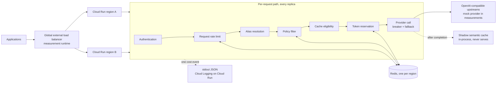

# Pusaq — an intelligent, cost-aware AI gateway

> **Pusaq** (Quechua: "the one who guides"). Pusaq guides every message to the
> right model, along the most convenient route.
>
> **In one sentence:** an LLM gateway between applications and models —
> rule-based routing across configured aliases, distributed rate limiting with
> token buckets in Redis, circuit breakers with fallback, a policy filter, and
> a semantic cache in shadow mode — a hand-built LiteLLM/Portkey whose claims
> are **distributed-systems properties, each measured with a published
> protocol**.

- Language: Go. State: Redis (rate-limit buckets, monthly spend). Upstreams: OpenAI-compatible servers; a mock provider for development and measurement. Measurement runtime: Cloud Run in two regions, one Memorystore per region.
- Development runs locally against Redis in Docker and a mock provider; cloud resources exist only for measurement runs.
- Work is spec-driven — see [`../openspec/`](../openspec/) and the design rules in [`../CLAUDE.md`](../CLAUDE.md). Current capabilities are listed in the [README](../README.md).

---

## Table of contents

- [1. What Pusaq is](#1-what-pusaq-is)
- [2. The problem](#2-the-problem)
- [3. Architecture](#3-architecture)
- [4. The path of a request](#4-the-path-of-a-request)
- [5. Theory and key mechanisms](#5-theory-and-key-mechanisms)
- [6. Technology choices](#6-technology-choices)
- [7. Design constraints](#7-design-constraints)
- [8. Measurement protocol](#8-measurement-protocol)

---

## 1. What Pusaq is

Imagine a company with three applications: a support chatbot, a document
extractor, and a coding assistant. Each could call a model provider directly —
and each team would end up reimplementing credentials, limits, retries, and
cost tracking.

Pusaq sits in the middle:

```
Applications → Pusaq → AI models
```

Applications only know Pusaq. For every request, Pusaq decides:

- whether the client is allowed in;
- whether it exceeded its limits;
- which model is the right one to use;
- whether its tenant's policy admits it (including whether the shadow cache
  may observe it);
- what to do if that model fails;
- how much the request cost;
- what to record about it.

It is part receptionist, part traffic controller, part accountant.

**Example.** An application sends:

```json
{
  "model": "pusaq/auto",
  "metadata": { "feature_tag": "classify" },
  "messages": [
    { "role": "user", "content": "Classify this email as urgent or not urgent" }
  ]
}
```

Pusaq reasons by rules: the tenant is resolved from the API key → it is
within its request limit → the tag `classify` resolves `pusaq/auto` to
`pusaq/fast` → the tenant's policy admits the request → the token reservation
fits → the fast model answers. The response carries `X-Pusaq-Model` (the
route's physical model) and `X-Pusaq-Route-Reason: rule:classify`, and the
request leaves one cost event with tenant, model, usage, cost, and latency.

**What Pusaq is NOT.** Not a SaaS product (no UI, no real billing, no
self-service tenants). Not a LiteLLM fork (own code, minimal surface). It does
not serve models and does not train anything. It deliberately does **not**
chase provider breadth: the limiter, the cache, and the failover are proven
just as well with two models as with twenty; supporting N providers is plumbing
an existing gateway already does — understanding what happens when one fails is
what gets examined.

**Model aliases.** The `model` field accepts the aliases `pusaq/fast`,
`pusaq/best`, and `pusaq/auto`. The alias is the contract — "you declare the
intent, Pusaq picks the model". Physical model names never appear in code
(they change often and have retirement dates); they live in configuration.

## 2. The problem

Every company adopting LLMs walks the same curve: month 1, one team calls a
provider directly and it works; month 3, five teams call three providers, each
with its own key, SDK, error handling, and homemade retry; month 6, the
surprise invoice arrives (who spent it? nobody knows — keys don't distinguish
teams), a load test eats the shared quota and knocks the chatbot offline, and a
provider outage takes the whole product down because nobody built fallback.
Month 7: "we need a gateway".

The gateway answers four needs that arrive together — and are in tension:

| Need | Without a gateway | With a gateway |
|---|---|---|
| Cost control | Opaque invoices per provider | Cost accounting per tenant/feature/model; budgets with cutoffs |
| Per-tenant limits | One team exhausts the provider quota for everyone | Token buckets per tenant; the noisy neighbor only limits itself |
| Resilience | Provider outage = product outage | Failover to another backend or region; circuit breakers; degrade, don't die |
| One point of auth/observability/policy | N keys across N repos; zero traceability | One auth surface; one cost event per request; policies |

Cost accounting pushes toward logging everything (threatening hot-path
throughput); resilience pushes toward retries and hedging (threatening cost
control — a retry is duplicated tokens); exact limits push toward central
coordination (threatening latency). The gateway's design is the negotiation of
those tensions; every decision below is a chosen point in that space, not an
absolute truth.

The landscape validating the category: LiteLLM, Portkey, Kong AI Gateway,
OpenRouter, Cloudflare AI Gateway. Pusaq builds the same mechanisms in the
open, so that how they behave under load and failure can be measured rather
than assumed.

## 3. Architecture

Pusaq is a data plane. Its configuration — API keys, tenant policies, routes,
routing rules, prices, breaker parameters — is environment variables
validated at startup ([configuration](configuration.md)); there is no
control-plane service.



Telemetry path: every event is one JSON line on stdout; on Cloud Run that is
Cloud Logging, read back by `run_id`. In the measurement runtime, Cloud Run
reaches Memorystore through
[Direct VPC egress](https://docs.cloud.google.com/memorystore/docs/redis/connect-redis-instance-cloud-run),
which Google recommends over the older connectors for latency, throughput, and
cost.

## 4. The path of a request

0. **Admission (HTTP adapter).** Before the pipeline: an injected not-ready
   window refuses the request with `not_ready`, bodies are capped at 1 MiB,
   and `metadata.run_id` is validated. Refusals here emit no cost event.
1. **Accounting and request ID.** The outermost stage starts the clock and
   guarantees that every request admitted to the pipeline emits exactly one
   cost event; the next stage assigns the request ID.
2. **Authentication.** The API key resolves the tenant. Its policy (allowed
   models, prompt cap, monthly budget, fail-closed flag, content-rule actions,
   cache opt-out — `PUSAQ_TENANT_POLICIES`) is read by the steps that enforce
   it; a tenant without a policy is unrestricted.
3. **Request rate limit (RPM).** One atomic Lua round-trip to Redis decides.
   Rejection = Pusaq's own 429 with `retry_after` computed from the bucket
   state — the gateway speaks to its clients in the same language providers
   speak to it.
4. **Alias resolution.** `pusaq/auto` resolves through the routing rules by
   `metadata.feature_tag`; the alias names a route (physical model and
   backend chain), and the price finalizer is registered.
5. **Policy filter.** In order: allowed models (checked on the resolved alias,
   so a `pusaq/auto` request is denied rather than rerouted), the prompt cap,
   the content rules, and the monthly budget (a Redis read). A denial happens
   before the token charge, so it costs nothing. The content rules are measured
   heuristics (regex, checksums, cue words;
   [measurements](measurements/content-rules.md)) that flag personal data and
   secrets, instruction-override phrasing, and time-dependent questions; the
   kinds matched go on the cost event and a tenant may block on them. The
   filter does not rewrite or mask content and does not scan responses.
   (Deliberately *not* called a "prompt firewall" — regexes cannot promise
   that.)
6. **Cache eligibility.** Decided once per request; the single reason a
   request is not eligible goes on the cost event as `cache_skip`.
7. **Token reservation (TPM).** Only now — after alias resolution and policy —
   the TPM bucket charges input tokens plus a reserved estimate for output,
   once per request (the same model contract holds across the fallback chain).
8. **Provider call.** The OpenAI-compatible adapter calls the backend chain
   (see §5.5), streaming passed through if requested; every answered attempt
   feeds that backend's breaker, a started stream when it ends.
9. **Finalizers and event.** In registration order: price, monthly spend, TPM
   reconciliation (return the unused reservation — in a `defer`, so it runs on
   success, error, timeout, and cancellation alike), and the shadow-cache
   offer for eligible completions; then the cost event is emitted
   **asynchronously**.

Ordering is not negotiable: the RPM limiter runs first because rejecting is
the cheapest thing the gateway can do; the policy filter runs before cache
eligibility because the cache must never see content the filter flagged; TPM
is charged after alias resolution and policy so a denied request costs
nothing.

## 5. Theory and key mechanisms

### 5.1 Rate limiting: why token bucket

Four classic algorithms, one verdict:

| Algorithm | Bursts | Accuracy | Memory | Verdict |
|---|---|---|---|---|
| Token bucket | Yes (up to B) | Exact on average | O(1) per key | **Chosen** — legitimate bursts + O(1) |
| Leaky bucket | Smooths them | Exact | O(queue) | No — queueing adds latency to an already slow path |
| Fixed window | Double at the edge | Approximate | O(1) | No — the edge is unacceptable for real quotas |
| Sliding log/counter | Doesn't model bursts | Exact / bounded error | O(N) / O(1) | No — does not model bursts |

LLM traffic is spasmodic — a user fires five turns in twenty seconds, then
leaves for ten minutes. A limit that forbids that burst punishes legitimate
use. The bucket parameters `B` (capacity, `PUSAQ_RPM_BURST`) and `r` (refill
rate, `PUSAQ_RPM_LIMIT`) are global configuration; every tenant gets its own
bucket with those parameters.

### 5.2 The jump to distributed: atomic Lua

Pusaq runs as M replicas; a local counter per replica makes the effective
limit `M × limit` — and M changes with autoscaling. Bucket state lives in
Redis, shared by all replicas.

The race that defines the problem: naive read → decide → decrement lets two
replicas read the same balance and both pass with one token. The fix: Redis
executes a Lua script as **one atomic operation** — read state, lazy-refill by
elapsed time, decide, decrement, persist with TTL, and return
verdict + balance + suggested retry, all in a single round-trip. Details that
matter: the bucket starts **full** (a new tenant can use its burst
immediately); refill is computed lazily at read time (no background refiller);
idle buckets expire via TTL; `retry_after` is returned computed.

Every admission, adjustment and lease acquisition reads `TIME` inside its
Lua operation. Redis is the shared refill clock; gateway wall-clock offsets
do not create extra refill. The saved timestamp never moves backward. When
store time is behind it, refill pauses and retry guidance includes that
catch-up delay. The existing keys and balances are preserved. Redis 7 uses
effects replication, which permits `TIME` inside a writing script; this
still uses one network round-trip. Store clock jumps remain an infrastructure
property, and mixed gateway versions retain the older writer's behavior.

The cost — one Redis round-trip per request (under 0.5 ms on a local Redis;
[measurements](measurements/limiter-exactness.md)) — has a measured
alternative: **lease mode** (`PUSAQ_RATELIMIT_MODE=lease`), where each replica
takes a batch of up to K request tokens in one atomic operation and admits K
requests locally. Tokens are taken before they are spent, so cumulative
admissions never exceed the bucket; what relaxes is the window: across M
replicas up to `M×K` tokens sit in leases, unspent and invisible to the store.
Unused tokens return to the bucket when a lease expires (lease TTL) or the
replica drains; a replica that dies without draining strands at most K per
tenant — under-admission, never overrun. A denial is cached locally until the
store's retry time or the lease TTL, whichever comes first, so overload costs
about one round-trip per interval instead of one per request. Lease mode
covers request limits only; token limits stay strict. Pusaq implements both
modes and **measures both**: limit exactness under aggressive concurrency vs
round-trips and latency added by the limiter.

**Store outage.** When Redis does not answer, the request limit, the token
charge, and the budget read fail open by default after at most 250 ms per
call, each logged — a gateway that
rejects everything because its semaphore died trades a cost problem for an
availability outage. A tenant with `fail_closed=true` gets 503
`store_unavailable` instead. A reconciliation that fails leaves its charge in
the bucket until the bucket's TTL; a spend update that fails under-counts the
month.

### 5.3 The limit that actually matters: TPM

RPM protects infrastructure; invoices and provider quotas are measured in
**tokens per minute**. A tenant doing 10 requests/min of 100k tokens each
costs more than one doing 1,000 short ones. Pusaq limits both.

The non-trivial part: output tokens are unknown until the response ends. The
design: **reserve on admission** (an input-token estimate plus an output
reservation — the request's `max_tokens`, or `PUSAQ_TPM_RESERVE_DEFAULT`
when absent), **reconcile on completion** (return the difference, another
atomic Lua script) in a finalizer that runs on success, error, and stream
end alike. A request whose usage never becomes known keeps its full charge;
idle buckets expire with the bucket's TTL. Between admission and
reconciliation the bucket is wrong by the reservation error, so a tenant
that under-reserves can consume more than its bucket allows before the
correction lands: the window total still stays within the bound, and the
peak excess is bounded by the burst's worth of under-reserved admissions —
measured, not asserted ([measurements](measurements/tpm-overrun.md)).

### 5.4 Semantic cache

An exact cache only matches byte-identical prompts. A semantic cache matches
meaning: "How do I cancel my subscription?" and "I want to close my account"
— embed the prompt, search the nearest neighbor among answered prompts. Pusaq's
index is an exact, in-process flat cosine index per replica, namespaced and
capped by entry count (`PUSAQ_CACHE_MAX_ENTRIES`, LRU); per-replica counts
undercount the hits a shared index would see.

**The central danger: false positives.** "What is the capital of Peru?" and
"What is the capital of Bolivia?" can score ~0.93 similarity — *between* real
paraphrases (0.95–0.98) and noise (0.88). A semantic cache can lie with
confidence; an exact cache never lies. Therefore:

- τ is calibrated on a labeled dataset of equivalent pairs and trap pairs
  (swapped entities, negations, dates) — chosen as
  `τ* = min{τ : precision(τ) ≥ 0.99}`, recall being whatever follows.
- The cache runs in **shadow mode only**: it logs the hit it *would* have
  served, the model is still called, and nothing is ever served from the
  cache.
- `make calibrate` writes the precision/recall curve and prints τ* or fails
  explicitly; a hit-rate is only published next to its false-positive rate. A
  hit-rate without its FP rate is marketing, not engineering.

**The cache key** (constitution rule 2): tenant | the route's physical model |
system prompt | the request's temperature (or `none` when absent) | the
eligibility-rules version, plus fixed `tools=none` and `format=none` markers —
the accepted request subset carries neither tools nor a response format.
Language is content, not configuration: it lives in the embedding space.
Entries have no TTL and there is no purge; the LRU cap bounds the index and a
restart empties it.

**What is never offered to the cache:** requests of a tenant that opted out,
multi-turn conversations (turn N depends on N−1), prompts the content rules
flag as sensitive, injection-like, or time-dependent ("today's dollar rate"),
and requests with an explicit temperature above 0.7. The decision is made
once per request and the single reason is recorded on the cost event as
`cache_skip`, so what the cache never saw is auditable next to what it did.

**The business metric** is a subtraction, not a percentage:
`net savings = (hits × avoided model cost) − (all requests × embedding cost) − index infra cost`.
The embedding toll is paid on *every* request, hit or miss — there is a
minimum hit-rate below which a cache loses money. The shadow cache records the
embedder latency of every evaluation (`embed_latency_ms`); cost events do not
price the embedding toll.

### 5.5 Routing

Model prices differ by an order of magnitude, and a large share of real
traffic is simple work the cheap model solves equally well. **The router needs no AI
to decide** — an explicit table is easier to understand and audit:

```
classify → fast     extract → fast     reason → best
code     → best     default → fast     (fail toward savings)
```

The table is configuration (`PUSAQ_ROUTING_RULES`, keyed by the request's
`metadata.feature_tag`); `pusaq/auto` resolves through it to a concrete
alias, and every response says how in `X-Pusaq-Route-Reason` (`direct`,
`rule:<tag>`, `default:untagged`, `default:unknown_tag`), recorded on the
cost event as `route_reason` next to `feature_tag`.

The router is a static table: there is no learned routing, no cascade, and no
LLM judge. A judge in the synchronous decision path of every request would
reintroduce the cost the router exists to remove.

**Fallback.** Every alias shares one backend chain: the first `PUSAQ_UPSTREAMS`
entry is the primary, the rest are fallbacks in order, all called with the
route's physical model name. A transport failure, a timeout, a non-200 answer
other than a rejection, a 200 without a completion, or an open breaker moves
the request to the next backend, at most once each, and counts as that
backend's failure; the token charge is made once, before the chain. A
provider's rejection of the request (400, 413, 422) is the client's error: it
ends the chain as `invalid_request` and counts as an answer, not a failure.
When the client leaves, the chain stops, the interrupted attempt feeds no
breaker, and the event records `client_canceled`. Streams fall back only
before the first byte — a started stream is never silently restarted. No
idempotency key is sent upstream.

### 5.6 Failover and circuit breakers

Two distinct failures: a backend dies (errors everywhere), or one of Pusaq's
own regions dies. Handled by different pieces:

- **Circuit breaker per backend** — one per backend in each process: closed /
  open / half-open, with a minimum-request threshold on the failure window
  (2 failures out of 2 requests is not a signal), cooldown, and K probe
  requests in half-open. Detection and recovery times are measured, not
  asserted: every transition is a `breaker_state` log record, the parameters
  are configuration (`PUSAQ_BREAKER_*`), and `make breakertest` fails the mock
  provider at a known instant and reads both times from the logs
  ([measurements](measurements/breaker-detection.md)).
- **Health signal** — passive only: real traffic outcomes. Half-open is
  entered on the next request after the cooldown, so a backend that receives
  no traffic stays open.
- **Regional failover** — the global load balancer redirects *new* requests
  when region A's readiness fails (Cloud Run service health over serverless
  NEGs: a region whose instances fail their readiness probe stops receiving
  new requests). What is Pusaq's own job: draining (mark not-ready, keep
  serving in-flight requests through a grace period), and the injection
  knob the chaos run uses instead of deleting a service — a token-guarded
  admin endpoint opens a not-ready window during which `/readyz` answers
  503 and new requests are refused with `not_ready` while in-flight streams
  finish. Every response and event names its region, so the run is read
  back per region ([measurements](measurements/regional-failover.md)). The
  two-region runtime module exists only for measurement runs.
- **One Redis per region, deliberately.** A global Redis would put an
  inter-region RTT in every request's hot path and couple both regions'
  availability. The price — accepted and documented — is that limits are
  per-region during failover (split quotas, e.g. 50/50, or a bounded
  overrun). Choosing failure independence over perfect limit consistency is
  the point being demonstrated.

### 5.7 Observability: cost accounting as the product

The gateway sees every LLM request in the company — its log *is* the AI cost
accounting system. Every request admitted to the pipeline emits one
`cost_event`: request ID, timestamp, operation, tenant, outcome and error
code, latency; for completions, the requested model, the route's physical
model (`served_model`), the route reason, prompt and completion tokens, and
the tokens charged; when present, the feature tag, run ID, region, policy
flags, cache-skip reason, the backend that served it and the attempts, the
**cost in $ against a versioned price table** (`PUSAQ_PRICES`,
`PUSAQ_PRICE_TABLE_VERSION`; the table version travels in the event — prices
change and historical reports must still add up), and the tenant's spend for
the month. A provider that answered without usage — a stream without its
usage chunk, a client that left mid-stream, a stream that failed — is priced
from the request's reservation and the event says so (`cost_estimated`); the
monthly spend counts that estimate. Shadow-cache evaluations are separate
`cache_shadow` records (similarity, neighbor, response fingerprints, embedder
latency), and breaker transitions are `breaker_state` records.

The write is asynchronous and may **never** block or slow the response path:
a single goroutine drains a bounded buffer and writes one line per event;
overflow drops the event and counts it, and the count is logged at shutdown
(`telemetry_dropped`) — losing an observability record is acceptable,
degrading a user request is not.

There is no dashboard and no metrics endpoint; reports are computed from the
event stream (`loadtest/verify-*.sh`).

## 6. Technology choices

| Technology | What it does here | Why |
|---|---|---|
| Go | The gateway itself | Hot proxy path: low p99, thousands of concurrent SSE streams (goroutines + net/http), static binary = minimal cold start. Honest note: LiteLLM proves Python *works*; Pusaq picks Go because the p99 is the point |
| HTTP + JSON, SSE | Public API and streaming | OpenAI-compatible subset — the lingua franca every SDK already speaks |
| Docker | Local = cloud parity | Full local development at $0 (Redis + mock provider in Compose) |
| Cloud Run + global external load balancer | Measurement runtime | Stateless gateway: two regions = two services behind serverless NEGs; **not GKE** — two clusters for a stateless service is paying for control planes without new learning |
| Redis (Memorystore in the cloud) | Request and token buckets, monthly spend | The limiter needs single-point atomic (Lua) sub-millisecond state; one instance **per region**. Breaker state and the shadow cache live in process memory |
| Lua scripts | Atomicity | Read-decide-decrement as one operation; races removed by construction |
| Embedders | Shadow-cache vectors | `local` (character trigrams, $0, deterministic) or any OpenAI-compatible `/embeddings` endpoint; the same code serves the gateway and `cmd/cachecal` |
| Terraform | IaC | The foundation and the two-region runtime, created and destroyed per measurement run |
| GitHub Actions + workload identity federation | CI and image publishing | Lint, race tests and Terraform validation on every PR; images published without stored keys |
| k6 | Load and chaos | Concurrency tests and failure injection |
| Mock provider | $0 experiments | Limiter and failover experiments need no real models — configurable latency and error rates |
| jq and shell | Verification | Every report is recomputed from k6 output, the mock's counters, and the cost events |

Local-dev caveat: Redis in Docker is faithful for Lua and atomicity but not
for Memorystore's real network latency or partitions — the local limiter p99
is an optimistic floor, and "what if Redis doesn't answer?" must be injected
deliberately (kill the container mid-run), not waited for.

## 7. Design constraints

Four constraints the architecture accepts explicitly:

1. **Multi-region is not scale-to-zero.** Automatic Cloud Run failover needs
   at least one min-instance per region — "always-on failover" and "zero cost
   at idle" are incompatible goals. The runtime module pins one instance per
   region (min = max = 1) and exists only for a run. See [Cloud Run service health](https://docs.cloud.google.com/run/docs/configuring/configure-service-health).
2. **Zero dropped streams cannot be promised.** The balancer redirects *new*
   requests; it cannot move an in-flight SSE connection out of a region that
   vanished. A graceful shutdown drains; a hard failure can cut streams
   ([Cloud Run request timeouts](https://docs.cloud.google.com/run/docs/configuring/request-timeout)
   warns long connections may drop and need reconnection). Measured
   separately: new requests redirected, normal requests recovered by retry,
   streams interrupted + reconnection time.
3. **Two regional Redis instances do not produce an exact global limit.**
   Each region knows its own consumption. Quotas are split (e.g. 50/50) or a
   bounded overrun during failover is accepted — never claim "exact global
   limit" when the architecture cannot guarantee it.
4. **Deleting a region is not a health-check test.** Deleting a service is
   not necessarily reported as unhealthy. Chaos experiments deliberately fail
   the readiness endpoint instead. See
   [service health limitations](https://docs.cloud.google.com/run/docs/configuring/configure-service-health).

## 8. Measurement protocol

Each property below has one reproducible command and a published report,
disappointing numbers included.

| Metric | Protocol | Reported |
|---|---|---|
| Limiter exactness ([report](measurements/limiter-exactness.md)) | `make loadtest` (strict, and `LOADTEST_MODE=lease`): two replicas behind nginx, one tenant at 10× its limit for 120 s and 300 s, a co-tenant under its limit, against the mock | Admitted vs bound, co-tenant 429s, Lua calls per request, limiter toll p50/p95/p99 per mode |
| Token-limit overrun ([report](measurements/tpm-overrun.md)) | `make tpmtest`: token limiting on, emulated upstream latency, an under-reserving and an over-reserving tenant at the same rate | Σconsumed vs the bucket bound over the window, peak excess vs the stated ceiling, reservation error per request, requests in flight |
| Breaker detection ([report](measurements/breaker-detection.md)) | `make breakertest`: the mock primary fails on command for a known window under steady traffic with a healthy fallback | Detection time (failure start → breaker open), recovery time (failure end → closed), probes, extra attempts, fallback-served requests, client errors (must be zero) |
| Regional failover ([report](measurements/regional-failover.md)) | `make chaos-run`: the two-region runtime module, sustained k6 against the global LB, region A's readiness failed at a known instant through the admin endpoint; every request tagged with the run id and answered with its region; per-region readiness probes as an independent timeline | Time until new requests are answered by the other region, longest interval without a success, first-attempt failures / recovered by one retry / failed after retry, streams complete / interrupted / refused, latency before / during / after per region, the split tenant's admissions per region (**counted, not estimated**, cross-checked against the gateways' events) |
| Content rules ([report](measurements/content-rules.md)) | `go test -v -run TestContentRulesCorpus ./internal/policy`: the policy filter's sensitive-data, injection and temporal rules against a labeled EN/ES corpus with hard negatives | Precision and recall per family against published floors the suite enforces; every miss and false alarm listed |
| Cache threshold calibration | `make calibrate`: the τ sweep over a labeled pair dataset with the gateway's own embedder | The precision/recall curve and τ*, or an explicit failure when no τ reaches the precision floor |

Experiment rules: hypothesis written before running; every run's id names its
output files, and the failover run also tags each request with
`metadata.run_id`; limiter/failover runs hit the mock provider (exactness at
zero token cost); **an ugly number is published anyway, with its
explanation**.
