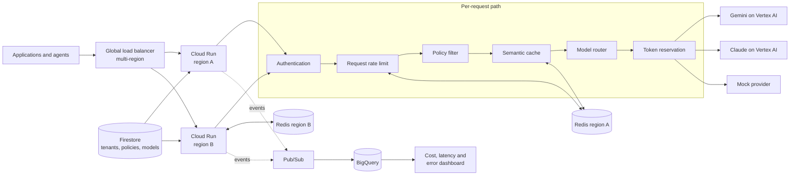

# Pusaq — an intelligent, cost-aware AI gateway

> **Pusaq** (Quechua: "the one who guides"). Pusaq guides every message to the
> right model, along the most convenient route.
>
> **In one sentence:** a production-grade LLM gateway between applications and
> models — semantic caching, cost/quality routing across Vertex AI models,
> distributed rate limiting with token buckets in Redis, cross-region failover,
> and a policy filter — a hand-built LiteLLM/Portkey whose real deliverable is
> **distributed-systems properties demonstrated with numbers**.

- Language: Go. Runtime: Cloud Run. State: Memorystore (Redis). Models: Vertex AI (Gemini + Claude) plus a mock provider.
- Development runs locally against Redis in Docker and a mock provider; cloud resources exist only for measurement runs.
- Work is spec-driven — see [`../openspec/`](../openspec/) and the design rules in [`../CLAUDE.md`](../CLAUDE.md). Current capabilities are listed in the [README](../README.md).

---

## Table of contents

- [1. What Pusaq is](#1-what-pusaq-is)
- [2. The problem](#2-the-problem)
- [3. Architecture](#3-architecture)
- [4. The path of a request](#4-the-path-of-a-request)
- [5. Theory and key mechanisms](#5-theory-and-key-mechanisms)
- [6. Technology choices](#6-technology-choices)
- [7. Design constraints](#7-design-constraints)
- [8. Measurement protocol](#8-measurement-protocol)
- [9. Risks](#9-risks)

---

## 1. What Pusaq is

Imagine a company with three applications: a support chatbot, a document
extractor, and a coding assistant. Each could call Gemini, Claude, or another
model directly — and each team would end up reimplementing credentials,
limits, retries, and cost tracking.

Pusaq sits in the middle:

```
Applications → Pusaq → AI models
```

Applications only know Pusaq. For every request, Pusaq decides:

- whether the client is allowed in;
- whether it exceeded its limits;
- whether a previous answer can be reused;
- which model is the right one to use;
- what to do if that model fails;
- how much the request cost;
- what to record about it.

It is part receptionist, part traffic controller, part accountant.

**Example.** An application sends:

```json
{
  "model": "pusaq/auto",
  "messages": [
    { "role": "user", "content": "Classify this email as urgent or not urgent" }
  ]
}
```

Pusaq reasons by rules: the task is classification → it does not need the most
expensive model → the client still has quota → no reusable cached answer →
use the fast, cheap model. It responds normally, adding internal metadata:
model chosen and why, estimated cost, cache hit/miss, latency — and the
`X-Pusaq-Model` response header.

**What Pusaq is NOT.** Not a SaaS product (no UI, no real billing, no
self-service tenants). Not a LiteLLM fork (own code, minimal surface). It does
not serve models and does not train anything. It deliberately does **not**
chase provider breadth: the limiter, the cache, and the failover are proven
just as well with two models as with twenty; supporting N providers is plumbing
an existing gateway already does — understanding what happens when one fails is
what gets examined.

**Model aliases.** The `model` field accepts concrete aliases or router
aliases: `pusaq/fast`, `pusaq/best`, `pusaq/auto`. The alias is the contract —
"you declare the intent, Pusaq picks the model". Physical model names never
appear in code (they change often and have retirement dates); they live in
configuration. See [model versions and lifecycle](https://docs.cloud.google.com/gemini-enterprise-agent-platform/models/model-versions).

## 2. The problem

Every company adopting LLMs walks the same curve: month 1, one team calls a
provider directly and it works; month 3, five teams call three providers, each
with its own key, SDK, error handling, and homemade retry; month 6, the
surprise invoice arrives (who spent $30k? nobody knows — keys don't
distinguish teams), a load test eats the shared quota and knocks the chatbot
offline, and a provider outage takes the whole product down because nobody
built fallback. Month 7: "we need a gateway".

The gateway answers four needs that arrive together — and are in tension:

| Need | Without a gateway | With a gateway |
|---|---|---|
| Cost control | Opaque invoices per provider | Cost accounting per tenant/feature/model; budgets with cutoffs |
| Per-tenant limits | One team exhausts the provider quota for everyone | Token buckets per tenant; the noisy neighbor only limits itself |
| Resilience | Provider outage = product outage | Failover to another model/region; circuit breakers; degrade, don't die |
| One point of auth/observability/policy | N keys across N repos; zero traceability | One auth surface; centralized traces and policies |

Cost accounting pushes toward logging everything (threatening hot-path
throughput); resilience pushes toward retries and hedging (threatening cost
control — a retry is duplicated tokens); exact limits push toward central
coordination (threatening latency). The gateway's design is the negotiation of
those tensions; every decision below is a chosen point in that space, not an
absolute truth.

The landscape validating the category: LiteLLM, Portkey, Kong AI Gateway,
OpenRouter, Cloudflare AI Gateway. Vertex AI brings loose pieces (per-project
quotas, *exact* context caching, multi-region endpoints) but not the
multi-tenant control plane nor routing across model families. Pusaq builds
the same mechanisms in the open, so that how they behave under load and
failure can be measured rather than assumed.

## 3. Architecture

Two planes:

- **Data plane** — processes requests. Must be fast and resilient.
- **Control plane** — stores configuration, prices, permissions, and reports.

Separating them turns the project into an understandable platform, not just a
proxy with many features.



Telemetry path: **Pusaq → Pub/Sub → BigQuery → dashboard**. Pub/Sub can write
directly into BigQuery through a [BigQuery subscription](https://docs.cloud.google.com/pubsub/docs/bigquery) —
no consumer service to maintain. Cloud Run connects to Memorystore via
[Direct VPC egress](https://docs.cloud.google.com/memorystore/docs/redis/connect-redis-instance-cloud-run),
which Google recommends over the older connectors for latency, throughput, and
cost.

## 4. The path of a request

1. **Authentication.** The API key resolves the tenant and loads its policy
   (limits, allowed models, flags). Example policy: team `support`,
   100 requests/min, $30/month budget, fast+standard models, cache enabled.
   Without a policy, nothing else runs.
2. **Request rate limit (RPM).** One atomic Lua round-trip to Redis decides.
   Rejection = Pusaq's own 429 with `retry_after` computed from the bucket
   state — the gateway speaks to its clients in the same language providers
   speak to it.
3. **Policy filter.** Allowed models, max prompt size, remaining budget,
   presence of sensitive data, cacheability. Basic injection heuristics and
   PII redaction before anything is cached or logged. (Deliberately *not*
   called a "prompt firewall" — regexes cannot promise that.)
4. **Semantic cache.** Prompt embedding → nearest neighbor → if similarity ≥ τ
   and the entry is cacheable, immediate response (recorded as a hit with the
   avoided cost). Miss → continue.
5. **Router.** Applies the endpoint/tag rule, consults circuit breakers (an
   open backend is skipped), picks provider + region.
6. **Token reservation (TPM/budget).** Only now — after model selection, and
   never for cache hits — the TPM bucket charges input tokens plus a reserved
   estimate for output.
7. **Provider call.** An adapter translates the common request to the specific
   provider format (streaming passthrough if requested). 429/5xx feed the
   breaker and trigger fallback with a retry budget.
8. **Post.** TPM reconciliation (return the unused reservation — in a
   `defer`, so it runs on success, error, timeout, and cancellation alike),
   outbound secret scan, cache population (if cacheable), and **asynchronous**
   cost/trace event emission.

Ordering is not negotiable: the RPM limiter runs before the cache because
rejecting is the cheapest thing the gateway can do; the policy filter runs
before the cache because caching unsanitized content is a privacy incident
waiting to happen; TPM is charged after model selection because a cache hit
consumed no model tokens and must not be billed as if it had.

## 5. Theory and key mechanisms

### 5.1 Rate limiting: why token bucket

Four classic algorithms, one verdict:

| Algorithm | Bursts | Accuracy | Memory | Verdict |
|---|---|---|---|---|
| Token bucket | Yes (up to B) | Exact on average | O(1) per key | **Chosen** — legitimate bursts + O(1) |
| Leaky bucket | Smooths them | Exact | O(queue) | No — queueing adds latency to an already slow path |
| Fixed window | Double at the edge | Approximate | O(1) | No — the edge is unacceptable for real quotas |
| Sliding log/counter | Doesn't model bursts | Exact / bounded error | O(N) / O(1) | Verification reference; counter is plan B |

LLM traffic is spasmodic — a user fires five turns in twenty seconds, then
leaves for ten minutes. A limit that forbids that burst punishes legitimate
use. The bucket parameters `B` (capacity) and `r` (refill rate) are per-tenant
policy: an interactive chatbot wants a high `B`; a batch backfill wants
`B ≈ r`.

### 5.2 The jump to distributed: atomic Lua

Pusaq runs as M replicas; a local counter per replica makes the effective
limit `M × limit` — and M changes with autoscaling. Bucket state lives in
Redis, shared by all replicas.

The race that defines the problem: naive read → decide → decrement lets two
replicas read the same balance and both pass with one token. The fix: Redis
executes a Lua script as **one atomic operation** — read state, lazy-refill by
elapsed time, decide, decrement, persist with TTL, and return
verdict + balance + suggested retry, all in a single round-trip. Details that
matter: the bucket starts **full** (a new tenant can use its burst
immediately); refill is computed lazily at read time (no background refiller);
idle buckets expire via TTL; `retry_after` is returned computed.

The cost — one Redis round-trip per request (~0.5–1 ms same-zone) — has a
measured alternative: **lease mode** (`PUSAQ_RATELIMIT_MODE=lease`), where
each replica takes a batch of up to K request tokens in one atomic operation
and admits K requests locally. Tokens are taken before they are spent, so
cumulative admissions never exceed the bucket; what relaxes is the window:
across M replicas up to `M×K` tokens sit in leases, unspent and invisible to
the store. Unused tokens return to the bucket when a lease expires (lease
TTL) or the replica drains; a replica that dies without draining strands at
most K per tenant — under-admission, never overrun. A denial is cached
locally until the store's retry time, so overload costs one round-trip per
retry interval instead of one per request. Lease mode covers request limits
only; token limits stay strict. Pusaq implements both modes and **measures
both**: limit exactness under aggressive concurrency vs round-trips and p99
added by the limiter. Documenting when to choose each is the point.

### 5.3 The limit that actually matters: TPM

RPM protects infrastructure; invoices and provider quotas are measured in
**tokens per minute**. A tenant doing 10 requests/min of 100k tokens each
costs more than one doing 1,000 short ones. Pusaq limits both.

The non-trivial part: output tokens are unknown until the response ends. The
design: **reserve on admission** (input tokens + an output estimate from a
historical percentile with a floor — not always `max_tokens`, which strangles
throughput), **reconcile on completion** (return the difference, another
atomic Lua script). Reservations carry a TTL so a request that dies mid-flight
never leaves tokens deducted forever, and reconciliation lives in a
`defer`/`finally`. The maximum observed overrun is reported as part of the
exactness metric.

### 5.4 Semantic cache

An exact cache only matches byte-identical prompts. A semantic cache matches
meaning: "How do I cancel my subscription?" and "I want to close my account"
— embed the prompt, nearest-neighbor search among answered prompts, serve the
stored answer if similarity ≥ τ.
[Memorystore already offers vector search](https://docs.cloud.google.com/memorystore/docs/redis/about-vector-search)
(exact and HNSW indexes), so no home-built distributed index is needed.

**The central danger: false positives.** "What is the capital of Peru?" and
"What is the capital of Bolivia?" can score ~0.93 similarity — *between* real
paraphrases (0.95–0.98) and noise (0.88). A semantic cache can lie with
confidence; an exact cache never lies. Therefore:

- τ is calibrated on a labeled dataset of equivalent pairs and trap pairs
  (swapped entities, negations, dates) — chosen as
  `τ* = min{τ : precision(τ) ≥ 0.99}`, recall being whatever follows.
- The cache ships in **shadow mode** first: it logs the hit it *would* have
  served, still calls the model, and precision is measured offline before a
  single cached answer reaches a user.
- The published deliverable is the precision/recall curve and the
  false-positive rate next to the hit-rate. A hit-rate without its FP rate is
  marketing, not engineering.

**The cache key is exhaustive** (constitution rule): tenant, model + version,
system prompt, tools, response format, temperature, language, policy version.
Anything less risks serving one tenant's answer to another or reusing an
answer produced under different instructions. Additionally: TTL per entry,
explicit namespace purge, LRU size cap.

**What is never cached:** prompts with personal/session context, temporal
prompts ("today's dollar rate"), multi-turn conversations (turn N depends on
N−1), high-temperature creative generation.

**The business metric** is a subtraction, not a percentage:
`net savings = (hits × avoided model cost) − (all requests × embedding cost) − index infra cost`.
The embedding toll is paid on *every* request, hit or miss — there is a
minimum hit-rate below which the cache loses money, and publishing that
break-even is part of the deliverable.

### 5.5 Routing

Model prices differ by an order of magnitude, and a large share of real
traffic is simple work the cheap model solves equally well. **The router needs no AI
to decide** — an explicit table is easier to understand and audit:

```
classify → fast     extract → fast     reason → best
code     → best     default → fast     (fail toward savings)
```

The table is configuration (`PUSAQ_ROUTING_RULES`, keyed by the request's
`metadata.feature_tag`); `pusaq/auto` resolves through it to a concrete
alias, and every response says how in `X-Pusaq-Route-Reason` (`direct`,
`rule:<tag>`, `default:untagged`, `default:unknown_tag`), recorded on the
cost event as `route_reason` next to `feature_tag`.

Documented extensions, deliberately not built yet: a learned router (no real
traffic to train it), and cascade/fallback-by-confidence (worst case pays both
models and doubles latency — batch endpoints only, never the interactive
path). Putting an LLM judge in the synchronous decision path of every request
reintroduces the cost the router exists to remove.

**Error fallback is non-negotiable:** on 429/5xx the router retries against an
equivalent backend with a retry budget and an idempotency request key, so a
fallback never duplicates downstream effects.

### 5.6 Failover and circuit breakers

Two distinct failures: a provider/model dies (5xx everywhere), or one of
Pusaq's own regions dies. Handled by different pieces:

- **Circuit breaker per provider×region** — closed / open / half-open, with a
  minimum-request threshold on the failure window (2 failures out of 2
  requests is not a signal), cooldown, and K probe requests in half-open.
  Detection and recovery times are measured, not asserted.
- **Health checking** — passive (real traffic outcomes) as the primary
  signal; active synthetic probes as the safety net in quiet hours and as the
  recovery probe.
- **Regional failover** — the global load balancer redirects *new* requests
  when region A's readiness fails. What is Pusaq's own job: draining
  (mark not-ready, keep serving in-flight requests through a grace period).
- **One Redis per region, deliberately.** A global Redis would put an
  inter-region RTT in every request's hot path and couple both regions'
  availability. The price — accepted and documented — is that limits are
  per-region during failover (split quotas, e.g. 50/50, or a bounded
  overrun). Choosing failure independence over perfect limit consistency is
  the point being demonstrated.

### 5.7 Observability: cost accounting as the product

The gateway sees every LLM request in the company — its log *is* the AI cost
accounting system. Every request emits one event: tenant, feature tag,
requested vs served model, routing decision and reason, cache hit/miss +
similarity, input/output tokens (reserved and actual), **cost in $ against a
versioned price table** (`PUSAQ_PRICES`, `PUSAQ_PRICE_TABLE_VERSION`; the
table version travels in the event — prices change and historical reports
must still add up), per-stage latency, region, result, policy-filter flags.

The write is asynchronous and may **never** block or slow the response path:
events are buffered and drained in batches; if the sink hiccups, records are
dropped *with a drop metric* — losing an observability record is acceptable,
degrading a user request is not.

Minimum dashboard: cost per tenant, cache savings, model distribution, errors
per provider, p50/p95/p99 latency, requests rejected by limits.

## 6. Technology choices

| Technology | What it does here | Why |
|---|---|---|
| Go | The gateway itself | Hot proxy path: low p99, thousands of concurrent SSE streams (goroutines + net/http), static binary = minimal cold start. Honest note: LiteLLM proves Python *works*; Pusaq picks Go because the deliverable is the p99 |
| HTTP + JSON, SSE | Public API and streaming | OpenAI-compatible subset — the lingua franca every SDK already speaks; [Google offers a compatible chat-completions endpoint](https://docs.cloud.google.com/vertex-ai/generative-ai/docs/reference/rpc) |
| Docker | Local = cloud parity | Full local development at $0 (Redis + mock provider in Compose) |
| Cloud Run | Hosting | Stateless gateway: multi-region = two services + a global LB; **not GKE** — two clusters for a stateless service is paying for control planes without new learning |
| Memorystore (Redis) | Buckets, cache, breaker state | The limiter needs single-point atomic (Lua) sub-millisecond state; one instance **per region** |
| Lua scripts | Atomicity | Read-decide-decrement as one operation; races removed by construction |
| Firestore | Control plane | Tenants, policies, aliases — durable, simple, cheap |
| Vertex AI | Model pool | One auth/billing plane for Gemini + [Claude on Google Cloud](https://docs.cloud.google.com/gemini-enterprise-agent-platform/models/partner-models/claude/use-claude) (region-dependent, must be enabled) |
| Vertex text embeddings | Cache toll | Cents per million tokens, tens of ms — the toll must be negligible |
| Pub/Sub → BigQuery | Telemetry | [Direct BigQuery subscription](https://docs.cloud.google.com/pubsub/docs/bigquery), no consumer service |
| OpenTelemetry | Traces | Per-stage latency through the pipeline |
| Terraform | IaC | Create and destroy GCP reproducibly; teardown discipline is a budget rule |
| k6 | Load and chaos | Concurrency tests, replay traffic, failure injection |
| Mock provider | $0 experiments | Limiter and failover experiments need no real models — configurable latency and error rates |
| Python (offline only) | τ calibration, analysis | Threshold sweeps and precision/recall curves are offline analysis, not hot path; right tool per layer |

Local-dev caveat: Redis in Docker is faithful for Lua and atomicity but not
for Memorystore's real network latency or partitions — the local limiter p99
is an optimistic floor, and "what if Redis doesn't answer?" must be injected
deliberately (kill the container mid-run), not waited for.

## 7. Design constraints

Four constraints the architecture accepts explicitly:

1. **Multi-region is not scale-to-zero.** Automatic Cloud Run failover needs
   at least one min-instance per region — "always-on failover" and "zero cost
   at idle" are incompatible goals. Min-instances are enabled only during the
   experiment window. See [Cloud Run service health](https://docs.cloud.google.com/run/docs/configuring/configure-service-health).
2. **Zero dropped streams cannot be promised.** The balancer redirects *new*
   requests; it cannot move an in-flight SSE connection out of a region that
   vanished. A planned shutdown drains; a hard failure can cut streams
   ([Cloud Run request timeouts](https://docs.cloud.google.com/run/docs/configuring/request-timeout)
   warns long connections may drop and need reconnection). Measured
   separately: new requests redirected, normal requests recovered by retry,
   streams interrupted + reconnection time.
3. **Two regional Redis instances do not produce an exact global limit.**
   Each region knows its own consumption. Quotas are split (e.g. 50/50) or a
   bounded overrun during failover is accepted — never claim "exact global
   limit" when the architecture cannot guarantee it.
4. **Deleting a region is not a health-check test.** Deleting a service is
   not necessarily reported as unhealthy. Chaos experiments deliberately fail
   the readiness endpoint instead. See
   [service health limitations](https://docs.cloud.google.com/run/docs/configuring/configure-service-health).

**Value hierarchy.** If anything must be cut, it is cut right to left: exact, verified
distributed rate limiting > semantic cache with published FP rate > multi-
region failover under load > cost/quality routing with a judge > policy
filter. The pair "atomic limiter under aggressive concurrency + cache with
measured false-positive rate" is never cut — without it there is no project,
only a proxy with extra features.

## 8. Measurement protocol

Every property Pusaq claims is measured under load or under injected failure,
with a written protocol. The numbers, once captured, are published next to
their protocol — including the ones that disappoint.

| Metric | Protocol | Reported |
|---|---|---|
| Semantic cache savings | Replay corpus grouped by intent with paraphrases, Zipf-distributed frequencies; same requests, same order, with and without cache | Hit-rate, net $ savings, latency reduction, **FP rate against corpus labels** |
| Limiter exactness | M replicas, N clients pushing 10× the limit ≥5 min against the mock; strict and lease modes | Accepted vs limit (± burst), max TPM overrun, p99 added per mode |
| Regional failover | Sustained k6 against the global LB; readiness of region A forced to fail at a known instant; sequence IDs per request | Availability gap, requests redirected / recovered by retry / streams interrupted (**counted, not estimated**) |
| Breaker detection | Mock starts returning 5xx at a known instant | Detection time (first 5xx → breaker open), recovery time (half-open → closed) |
| Router savings | Mixed-task dataset with reference answers; all-best vs router; LLM-as-judge rubric verifies quality within a declared margin | Z% savings at equivalent judged quality |

Experiment rules: hypothesis written before running; every run tagged with an
auditable `run_id` in the cost log; limiter/failover runs hit the mock
provider (exactness at zero token cost); **an ugly number is published anyway,
with its explanation** — a 20% hit-rate with a sensitivity analysis is worth
more than an inflated 80%.

## 9. Risks

| Risk | Mitigation |
|---|---|
| Semantic cache hit-rate disappoints (traffic without semantic repetition) | Zipf-realistic replay, declared; report hit-rate sensitivity to repetition skew. "The cache only pays with traffic this repetitive" is a publishable finding, not a failure |
| Badly calibrated τ serves wrong answers | Shadow mode first; τ chosen for precision ≥ 0.99, never for hit-rate; FP rate always published |
| Redis partition/outage vs limiter exactness | Documented degraded mode: **fail-open** with a conservative local limit (`limit/M` per replica) by default — a gateway that rejects everything because its semaphore died trades a cost problem for an availability outage; per-tenant `fail_closed` flag for hard budgets |
| Multi-region doubles deploy friction | Terraform from day one; one region-parameterized definition; no load run starts without clean `apply`/`destroy` cycles |
| Scope creep (more providers, UI, queues) | Mechanical gate: the headline numbers must be captured and script-reproducible before any new feature is considered |
